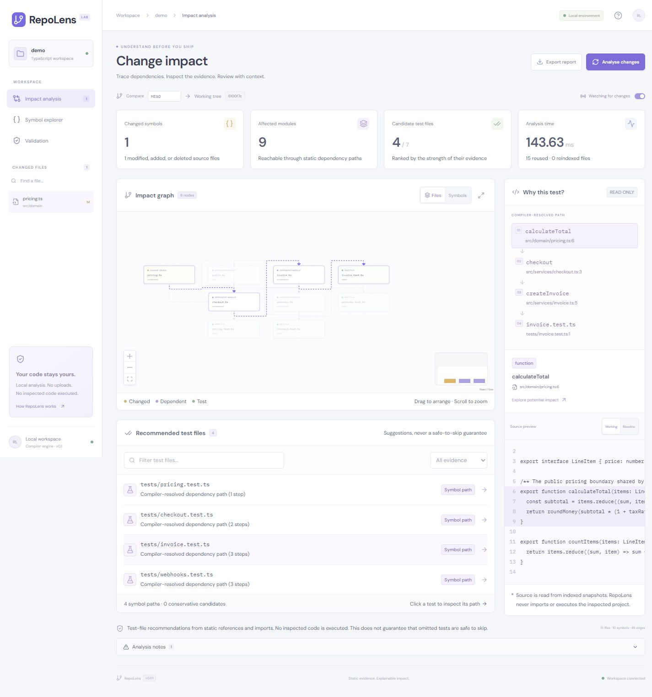

# RepoLens

**Understand a code change before you ship it.** RepoLens compares a Git revision with your working tree, follows TypeScript compiler references, and explains which modules and test files may be affected.

It combines a real analysis engine, a CLI, and a local graph dashboard. No model API key, hosted database, or code upload is required.



## Run the demonstration

Requirements: **Node.js 22.12+**, npm, and Git on PATH. Tested with Node 24 on Windows; CI checks Node 24 on Windows and Linux.

```sh
git clone https://github.com/LuciferAksh/repolens.git
cd repolens
npm ci
npm run dev
```

Open **http://127.0.0.1:4300**. This builds the application and creates a Git-backed shop fixture with a deliberate pricing regression in `data/demo`. Existing demo edits are preserved. Ctrl+C stops the server.

1. Inspect the changed pricing function and its dependency graph.
2. Click `tests/invoice.test.ts` to see the path: `calculateTotal → checkout → createInvoice → invoice.test.ts`.
3. Switch between working and baseline source snapshots.
4. Use **Symbol explorer** to simulate a symbol change without editing code.
5. Run `npm run verify`, then open **Validation** to see actual fixture test outcomes.

## Inspect your repository

Your repository must have at least one Git commit. RepoLens reads staged, unstaged, and nonignored untracked source as the working snapshot; it does not compare only the staging area.

```sh
npm run build
npm start -- --repo "/absolute/path/to/your/repository" --base HEAD
```

Windows example:

```powershell
npm start -- --repo "C:\projects\my-app" --base main
```

Only one local repository is served per process. Choose another loopback port with `--port 4301`. Source changes trigger a debounced rescan; pause watching in the dashboard when needed. Root tsconfig compiler options and path aliases are supported. Installed dependency declarations can improve compiler resolution; RepoLens never installs dependencies or executes inspected package scripts.

For CLI or CI use:

```sh
node dist/cli.js analyze --repo /path/to/repository --base HEAD
node dist/cli.js analyze --repo /path/to/repository --base main --json --out impact.json
node dist/cli.js analyze --repo /path/to/repository --symbol 'symbol:src/pricing.ts#calculateTotal'
```

`--out` explicitly writes the report. Analysis itself does not edit the inspected repository. The dashboard JSON export includes indexed symbol names, paths, and dependency evidence; review it before sharing.

## What makes it useful

- **Compiler-based symbol resolution:** imports, aliases, re-exports, calls, constructors, type references, and namespace access.
- **Historical evidence:** merges committed and working graphs so deleted code can retain its old callers. Edges record snapshot provenance.
- **Explainable recommendations:** reverse breadth-first traversal returns a shortest path, ranked by symbol evidence before conservative module evidence.
- **Incremental local sessions:** caches the resolved baseline and reuses unchanged AST extractions. An unchanged rescan avoids reindexing; a source change still rebuilds compiler bindings and graph relationships.
- **Interactive inspection:** file/symbol graphs, path highlighting, source snapshots, search, what-if exploration, watch mode, and JSON export.
- **Measured fixture evaluation:** compares recommendations against observed baseline and mutated test runs.

## Evidence and limits

The controlled shop evaluation starts with **7/7 passing test files**. A pricing surcharge causes **4 test files to fail**, and RepoLens recommends **all 4**. This is one known mutation, not a general accuracy benchmark. The external integration check uses a pinned `developit/mitt` checkout and selects its emitter consumer test using explicitly conservative package-source evidence; upstream code is not executed.

**Recommendations are review aids. They do not prove runtime reachability or guarantee that omitted tests are safe to skip.** Keep your normal test suite as the correctness gate.

Supported input is local TypeScript/JavaScript (including TSX/JSX), not every programming language. Inherited tsconfig/project-reference options are not expanded. Reflection, dynamic dispatch, nonliteral imports, external package internals, framework routing, runtime configuration, generated code, and non-source assets can escape analysis. Tests are identified by paths, not discovered through a test runner. Type-check diagnostics are not a full compilation check. See [limitations](docs/limitations.md).

## Development and verification

```sh
npm run build
npm test
npm run verify
npm run verify:upstream
npm run format:check
```

`verify` executes only our bundled shop fixture in a fresh temporary Git repository and writes `data/validation.json`. `verify:upstream` downloads pinned mitt source, requires a clean checkout, applies a temporary mutation, runs static analysis, and restores exact original bytes in `finally`. It does not run upstream tests or scripts. Generated checkouts, reports, dependencies, and build output are ignored by Git.

For frontend development, run the server on port 4300 and `npm run dev:web` separately; Vite serves port 5174 and proxies `/api` to the local server.

Read the [architecture](docs/architecture.md), [verification notes](docs/verification.md), and [contribution guide](CONTRIBUTING.md). MIT licensed.
