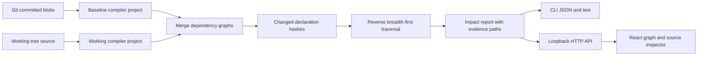

# Architecture

## Data flow

## Snapshots and resolution

`git.ts` resolves the requested revision to an immutable commit, enumerates committed files with `ls-tree`, and reads blob IDs using batched `cat-file`. The working snapshot combines tracked and nonignored untracked files; deleted files remain only in the baseline. Git arguments use `execFileSync` without a shell. No checkout, external diff, package script, or application import runs during analysis. CRLF is normalized to LF in both snapshots to avoid Windows checkout noise.

Each snapshot owns a TypeScript LanguageService in `indexer.ts`. A virtual file host keeps baseline source from falling through to current working files. Root compiler options are parsed as JSON, never evaluated. External declarations may be read from local node_modules, but external package implementations are not graphed. AST declaration extraction is cached by source version. Changed source reuses unchanged extractions, while the language service rebinds references and graph relationships across the project.

Nodes represent files and named functions, classes, methods, values, interfaces, and types. IDs use repository path plus qualified declaration name; they are stable across body edits, but renames behave as deletion plus addition. Declaration hashes include raw source text, so formatting and enclosing declaration changes can increase the changed set. Signature overloads share an ID. Symbols are not a complete language-independent semantic model.

## Graph semantics

Stored edges point **dependent → dependency**: a caller points to the function it calls. Relations include call, reference, type, import, re-export, and literal dynamic import. The dashboard reverses arrows to display impact flowing from a changed origin to dependents.

The union of baseline and current graphs preserves deleted dependencies. Each edge retains base/working/both provenance. Source previews can be switched to the baseline when following historical edges. A merged path is historical static evidence; its hops need not all coexist at runtime in the working version.

`impact.ts` traverses reverse edges in two separate modes. Symbol mode follows compiler-resolved call/reference/type relationships. Module mode follows imports/re-exports/dynamic imports as conservative file relationships. It does not silently promote a module edge to symbol confidence. Unbuilt packages with unavailable generated entry points can contribute a module edge through their in-repository package.json `source` field, with an explicit warning. This is metadata evidence only.

Recommendations are deduplicated by current test file and ranked symbol-before-module, then by shortest path. Tests are classified by test/spec directories or `.test`/`.spec` filename suffixes. This is test-file recommendation, not individual test-case discovery or execution coverage.

## Local application

The native Node HTTP server hosts a built React dashboard and an analysis worker. Heavy compiler work stays off the HTTP event loop. Worker requests have a 45-second deadline and a 768 MiB V8 old-generation memory limit; an aborted worker requires a server restart. Watch events are debounced; events during analysis request a later scan. Polling returns the graph only when its report ID changes.

The server binds to 127.0.0.1, rejects unexpected Host/Origin values, requires small JSON bodies for actions, and exposes source only from its indexed snapshot. It has no repository-upload or arbitrary filesystem endpoint. This is a local developer tool; there is no multi-user authentication or public-server deployment mode.

Source limits are 3,000 relevant files, 1 MiB per file, and 40 MiB total. Symlinked source and generated/dependency directories are excluded. The graph UI caps visible nodes at 80 with a notice; exported reports retain the full graph. These bounds are operational limits, not a sandbox for arbitrary hostile repositories.
